# Marktperspectief

A self-hosted dashboard for one investor's portfolio across brokers, with Claude as the analyst. Upload your broker exports and it values every holding daily, measures your returns against the market, tracks dividends and sold puts, and keeps a written thesis per holding. Claude reads all of it and records the trades and theses you tell it, through the app's MCP server.

Try the demo at https://marktperspectief-demo.vercel.app: an invented investor, reloaded every night. Claude can [connect to it](#connect-claude-to-the-demo) too.

<video src="https://github.com/user-attachments/assets/e4519396-6b8f-4102-baa2-42ca09474380" controls muted width="100%"></video>

<video src="https://github.com/user-attachments/assets/b6a76e35-af17-4651-a4e5-0c65429098dc" controls muted width="100%"></video>

<table>
  <tr>
    <td width="33%">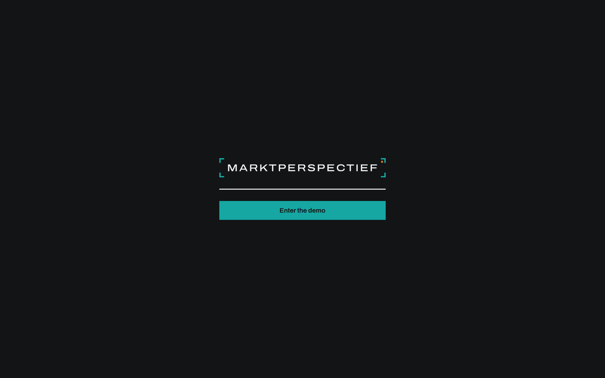<br><sub>The demo opens with one click, no passkey needed</sub></td>
    <td width="33%">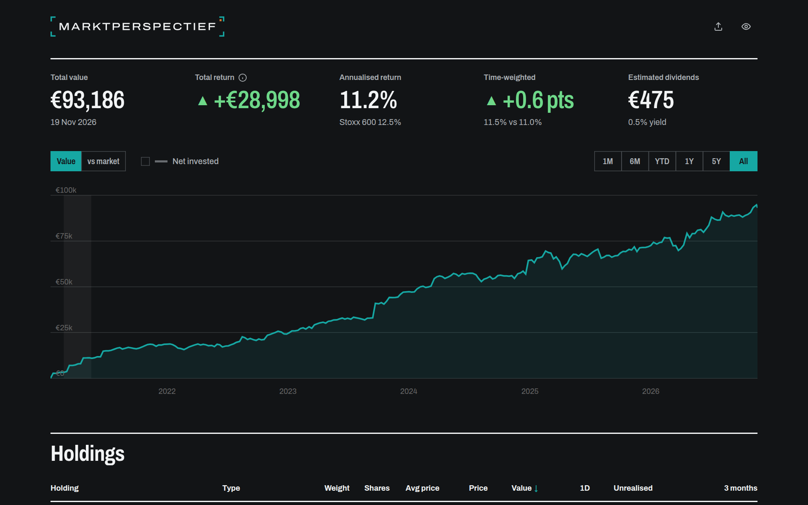<br><sub>Hover the chart for the portfolio's value on any day</sub></td>
    <td width="33%">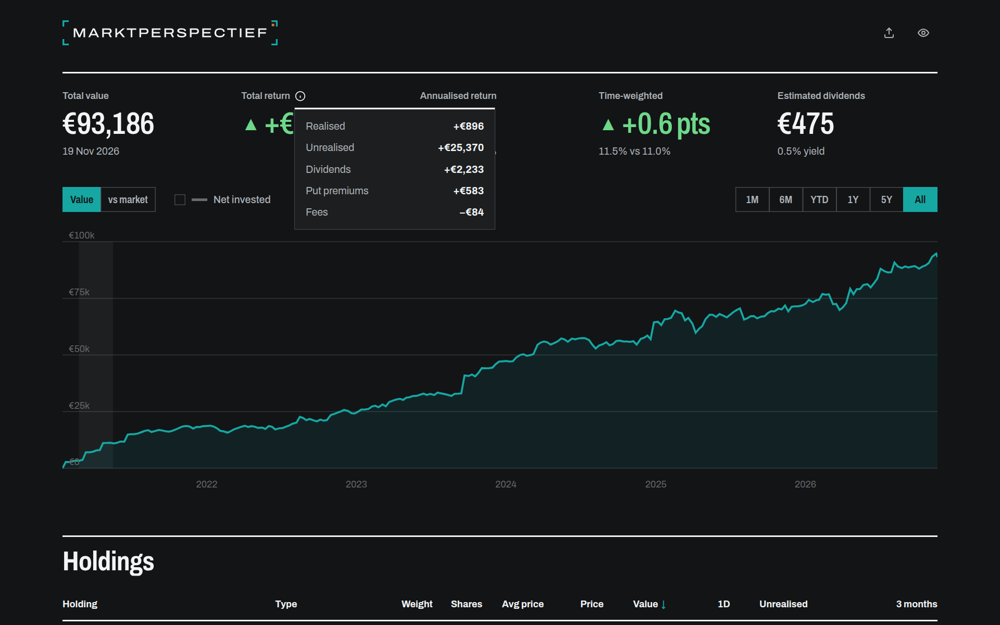<br><sub>Total return in parts: realised, unrealised, dividends, premiums, fees</sub></td>
  </tr>
  <tr>
    <td width="33%">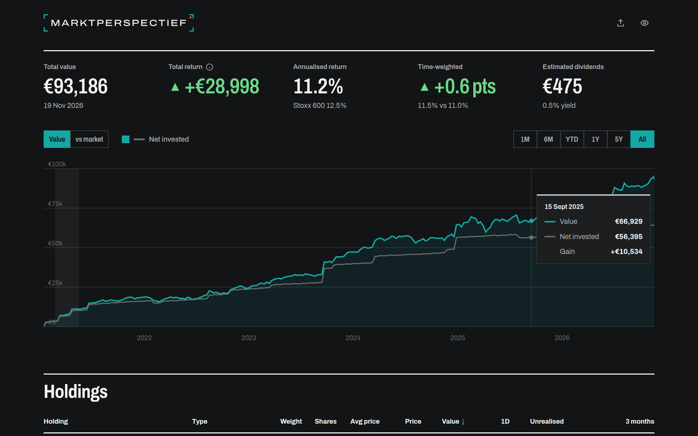<br><sub>Net invested is the money put in: the gap to the value is the gain</sub></td>
    <td width="33%">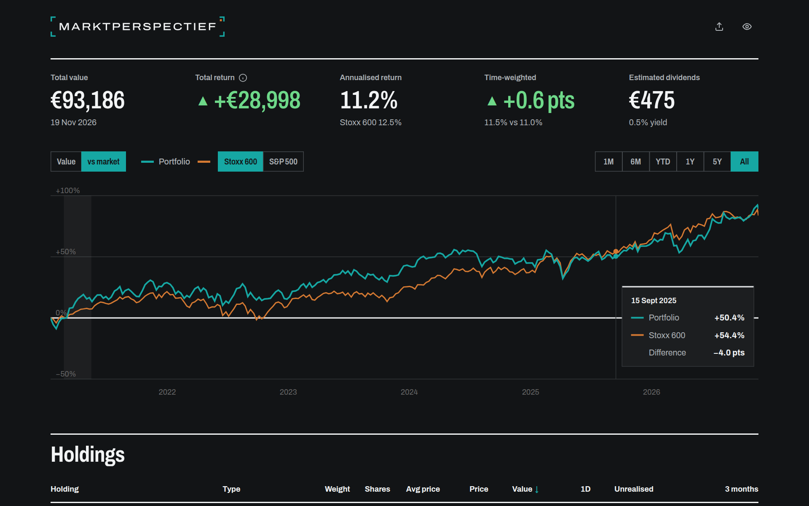<br><sub>vs market sets the time-weighted return against an index</sub></td>
    <td width="33%">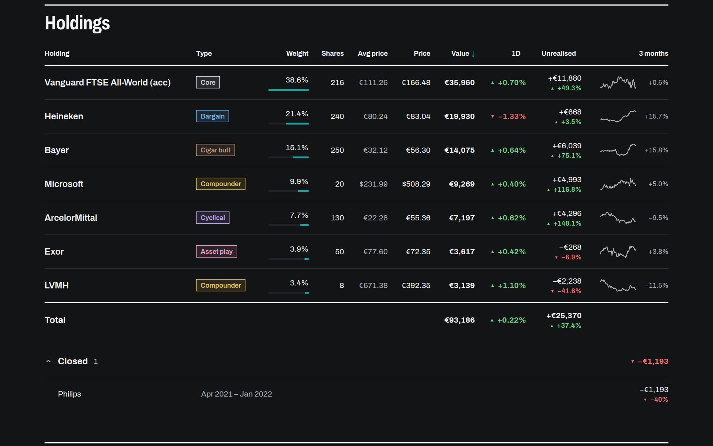<br><sub>Holdings by type and weight, then closed positions with their result</sub></td>
  </tr>
  <tr>
    <td width="33%">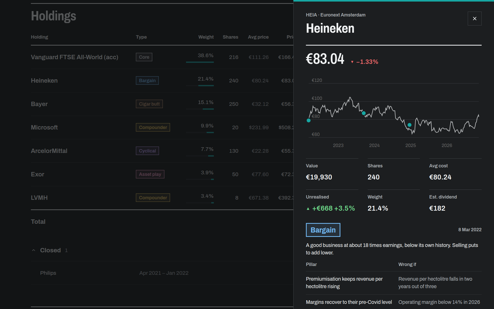<br><sub>A holding opens its chart with the trades marked, and its position</sub></td>
    <td width="33%">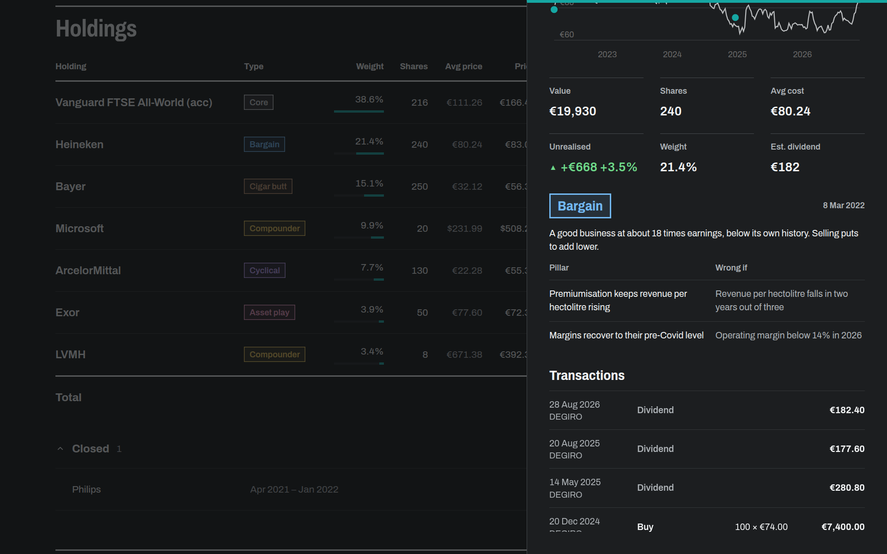<br><sub>Its thesis, and every trade and dividend with the broker that booked it</sub></td>
    <td width="33%">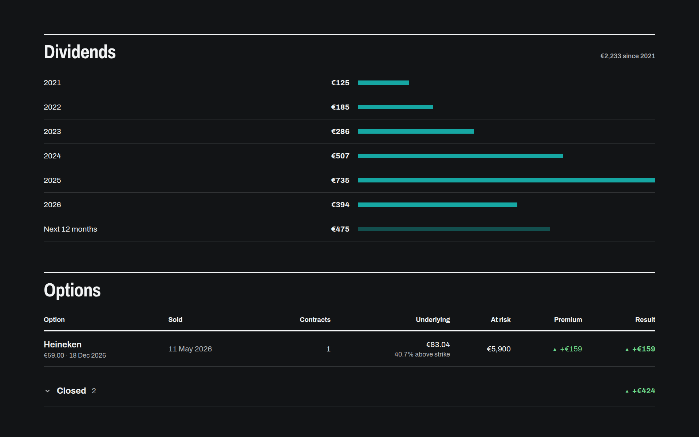<br><sub>Dividends received each year, and an estimate for the next 12 months</sub></td>
  </tr>
  <tr>
    <td width="33%">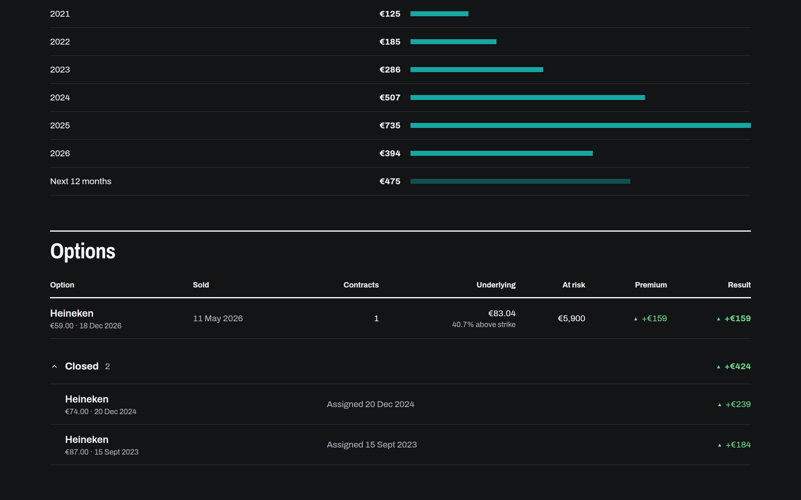<br><sub>Sold puts, valued at the underlying's last close</sub></td>
    <td width="33%">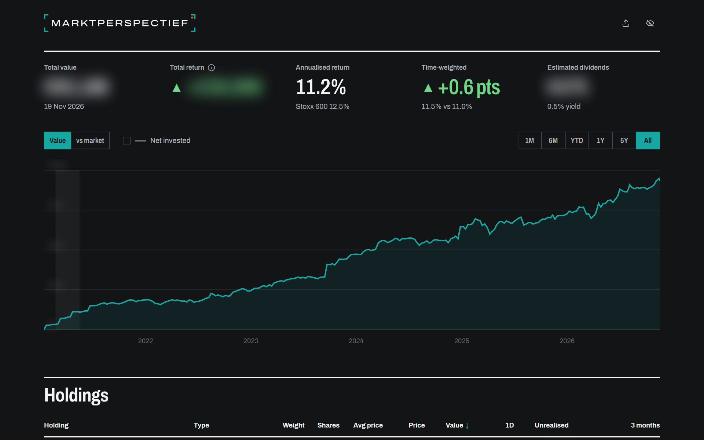<br><sub>The eye blurs every amount; percentages and prices stay readable</sub></td>
    <td width="33%">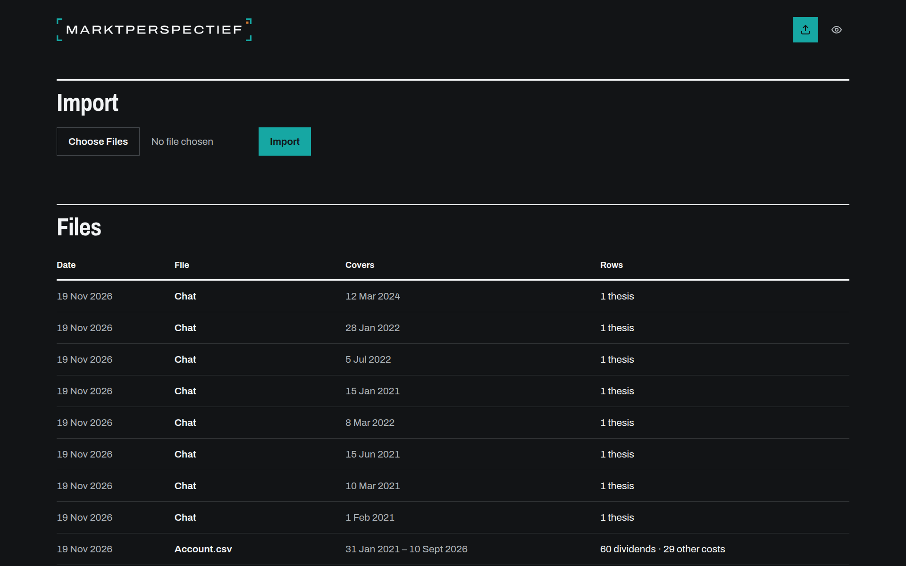<br><sub>Import takes broker exports, and lists every file with what it covered</sub></td>
  </tr>
</table>

## What it does

- **Imports** DEGIRO's Transactions export and Account statement, Saxo's Transacties export and a normalised Binck CSV. Every file is kept as uploaded, and the ledger can be rebuilt from those files alone.
- **Values** each holding at Yahoo Finance's daily close, in euros at the ECB's reference rates, through stock dividends, ISIN changes and moves between brokers.
- **Measures** the total return and the money-weighted (XIRR) and time-weighted returns over any range, against the Stoxx 600 and the S&P 500, and what the same euros would have made in the Stoxx 600.
- **Tracks** the dividends received, gross, with the next 12 months' estimate, the sold puts and their result, and the closed positions.
- **Keeps a thesis** per holding: its type (compounder, bargain, cyclical, …), two to four pillars and what would prove each one wrong.
- **Works with Claude** over MCP: a portfolio summary, a price refresh, and trades, theses and new securities told in chat, each shown as a card and kept as a draft until you press its Confirm button.
- **Answers questions** about a holding from its panel, where Claude reads the holding, the portfolio and the news and records nothing.
- Signs in with a passkey only, and a privacy toggle blurs every amount.

## Limits

- One owner per deployment.
- Euros are the base currency: holdings in USD, GBP or CHF convert at ECB rates, and options are euro puts only.
- DEGIRO's Account statement is read in Spanish and Saxo's export in Dutch. Another broker or language needs a parser in `src/lib/import/parsers/`.
- Prices come from Yahoo Finance through the unofficial `yahoo-finance2`, which is meant for personal use.
- The remote MCP endpoint accepts claude.ai as its only client.

## Run it locally

You need Node 22 or later and pnpm.

```bash
pnpm install
pnpm db:demo   # a local database with the demo investor; fetches prices from Yahoo and the ECB
pnpm dev       # http://localhost:3000, no sign-in on localhost
```

`pnpm db:migrate` gives an empty database instead. Locally the database is `.data/dev.db` and uploads are kept under `.data/blob/`, so no account or env var is needed.

## Your own portfolio

1. List your securities in an instruments file and upload it on `/import`, or ask Claude to add them:

   ```json
   {
       "chat": "instruments",
       "draftId": "6f1c2a8e-3b4d-4e5f-8a9b-0c1d2e3f4a5b",
       "instruments": [
           { "id": "heineken", "isin": "NL0000009165", "name": "Heineken", "currency": "EUR", "yahooSymbol": "HEIA.AS" }
       ]
   }
   ```

   `draftId` is any UUID. `aliases` map an older ISIN or a DEGIRO option code to an instrument, and `corporateActions` add the shares of a stock dividend that a broker books without a count.
2. Upload your broker exports on `/import`. A file with an unknown ISIN, or one that would sell more shares than you hold, is refused with the reason.

## Deploy

It runs on Vercel, with a Turso database and a private Vercel Blob store.

1. Fork the repo and import it as a Vercel project.
2. Create a Turso database, and connect a private Blob store to the project, which sets `BLOB_READ_WRITE_TOKEN`.
3. Set the other env vars in `.env.example`: `TURSO_DATABASE_URL`, `TURSO_AUTH_TOKEN`, `BETTER_AUTH_SECRET`, `BETTER_AUTH_URL` (your domain), `CRON_SECRET` and `AUTH_SETUP_TOKEN`, and optionally `OWNER_NAME`, `OWNER_TIME_ZONE` and `ANTHROPIC_API_KEY`, which turns on the holding panel's Ask button and bills your Anthropic account.
4. Deploy. The production build migrates the database. Functions run in Dublin (`dub1`): change `regions` in `vercel.json` to match your database.
5. Open `/login?setup`, enter the setup token and register your passkey.

There is no sign-up and no password: the only way in is a passkey, and registering one normally needs a session. `AUTH_SETUP_TOKEN` lets you register the first passkey without one, and proves it's you, since a new `vercel.app` address can be found within minutes of its first deploy. Generate it with `openssl rand -base64 32`. Once your passkey exists the token is refused, so removing it afterwards is tidying up rather than a must.

- **Another device:** sign in there with the passkey you have, synced or from your phone through the browser's QR code, then register one at `/login?setup` with the token left empty.
- **Every passkey lost:** delete your row in the `passkey` table, set a fresh token and register again.

Vercel cron calls `/api/cron/daily` at 22:00 and 05:00 UTC to fetch prices and rebuild the daily series.

## Claude

- **claude.ai** connects to `https://<your domain>/api/mcp` as a custom connector. Choose "Use Claude's published identity" rather than "Register automatically", then sign in with your passkey and allow access.
- **Claude Code** in a checkout starts the stdio MCP server from `.mcp.json`, on the local database.
- **The holding panel** has an Ask button when `ANTHROPIC_API_KEY` is set: Lens, the analyst on Claude (Opus 5.5, or Haiku 5.5 on the demo), answers about that holding with its trades, dividends, thesis and last year of closes at hand, can read the portfolio summary and search the web for news, with its sources linked under the answer, and calls no other tool. The conversation lasts while the panel is open.

A trade, a thesis or a new security told in chat comes back as a preview, kept as a draft for 30 minutes. On claude.ai the preview is a card, an [MCP App](https://github.com/modelcontextprotocol/ext-apps), and only its Confirm button saves it: the confirm tools are visible to the card alone, so Claude can't save a draft for you. Claude Code shows no card, so its stdio server lets Claude confirm once you've agreed to the preview in a message of your own; through the claude.ai connector, Claude Code can read the portfolio but not save. Keep `undo_chat_transaction` asking for approval rather than **Always allow**.

### Connect Claude to the demo

Add a custom connector on claude.ai with the URL `https://marktperspectief-demo.vercel.app/api/mcp`, choosing "Use Claude's published identity". The sign-in page offers "Enter the demo" instead of a passkey; allow access, then ask Claude how the portfolio is doing, or tell it a trade and confirm the card. What you save lasts until the demo reloads at night.

### Evals

`evals/` holds Claude to the rules above. Each case is a scripted chat that a real model plays out against the MCP server on an in-memory portfolio, and a check on what it did: it never confirms a draft the user hasn't answered, it leaves saving to the card where there is one, it passes on the preview's warnings, it doesn't bend a refused sell into one the ledger takes, a question writes nothing, an undo takes back the right trade, and Lens answers about the holding whose panel is open. Every case runs three times and has to pass all three.

```bash
ANTHROPIC_API_KEY=… pnpm eval   # EVAL_MODEL (claude-sonnet-5-5), EVAL_RUNS (3) and EVAL_CASE (part of a name) are optional
```

The Evals workflow runs them on every PR that touches the MCP server or the evals, with the repo secret `ANTHROPIC_API_KEY`, and by hand against any model.

## Architecture

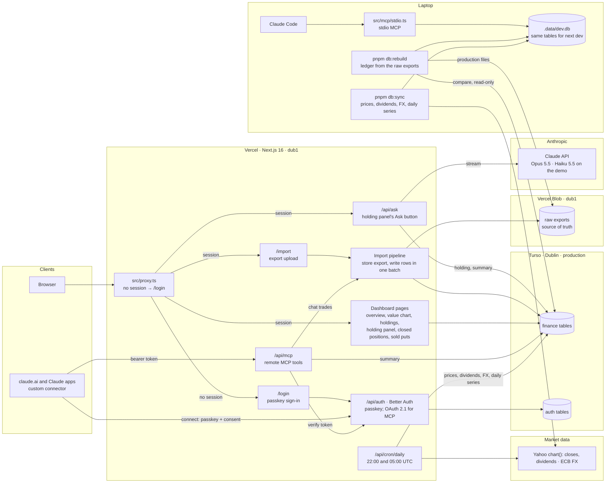

The portfolio math is pure functions in `src/lib/engine`, shared by the pages, the MCP tools in `src/mcp` and the import pipeline in `src/lib/import`. `CLAUDE.md` holds the project's rules and decisions.

## Development

`pnpm typecheck`, `pnpm lint`, `pnpm db:check` and `pnpm test` are what CI runs on every PR, and `pnpm format` formats. `pnpm db:sync` fetches prices into the local database, and `pnpm db:rebuild` rebuilds it from production's raw files, which needs `vercel env pull` first.

## Licence

MIT, see [LICENSE](LICENSE).
