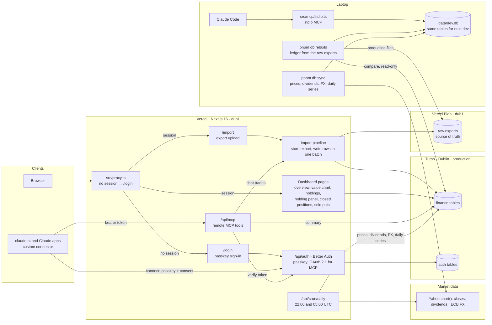

# Marktperspectief

A self-hosted dashboard for one investor's portfolio across brokers, with Claude as the analyst. Upload your broker exports and it values every holding daily, measures your returns against the market, tracks dividends and sold puts, and keeps a written thesis per holding. Claude reads all of it and records the trades and theses you tell it, through the app's MCP server.

Try the demo at https://marktperspectief-demo.vercel.app: an invented investor, reloaded every night.

## What it does

- **Imports** DEGIRO's Transactions export and Account statement, Saxo's Transacties export and a normalised Binck CSV. Every file is kept as uploaded, and the ledger can be rebuilt from those files alone.
- **Values** each holding at Yahoo Finance's daily close, in euros at the ECB's reference rates, through stock dividends, ISIN changes and moves between brokers.
- **Measures** the total return and the money-weighted (XIRR) and time-weighted returns over any range, against the Stoxx 600 and the S&P 500, and what the same euros would have made in the Stoxx 600.
- **Tracks** the dividends received, gross, with the next 12 months' estimate, the sold puts and their result, and the closed positions.
- **Keeps a thesis** per holding: its type (compounder, bargain, cyclical, …), two to four pillars and what would prove each one wrong.
- **Works with Claude** over MCP: a portfolio summary, a price refresh, and trades, theses and new securities told in chat, each kept as a draft until you confirm it.
- Signs in with a passkey only, and a privacy toggle blurs every amount.

## Limits

- One owner per deployment.
- Euros are the base currency: holdings in USD, GBP or CHF convert at ECB rates, and options are euro puts only.
- DEGIRO's Account statement is read in Spanish and Saxo's export in Dutch. Another broker or language needs a parser in `src/lib/import/parsers/`.
- Prices come from Yahoo Finance through the unofficial `yahoo-finance2`, which is meant for personal use.
- The remote MCP endpoint accepts claude.ai as its only client.

## Run it locally

You need Node 22 or later and pnpm.

```bash
pnpm install
pnpm db:demo   # a local database with the demo investor; fetches prices from Yahoo and the ECB
pnpm dev       # http://localhost:3000, no sign-in on localhost
```

`pnpm db:migrate` gives an empty database instead. Locally the database is `.data/dev.db` and uploads are kept under `.data/blob/`, so no account or env var is needed.

## Your own portfolio

1. List your securities in an instruments file and upload it on `/import`, or ask Claude to add them:

   ```json
   {
       "chat": "instruments",
       "draftId": "6f1c2a8e-3b4d-4e5f-8a9b-0c1d2e3f4a5b",
       "instruments": [
           { "id": "heineken", "isin": "NL0000009165", "name": "Heineken", "currency": "EUR", "yahooSymbol": "HEIA.AS" }
       ]
   }
   ```

   `draftId` is any UUID. `aliases` map an older ISIN or a DEGIRO option code to an instrument, and `corporateActions` add the shares of a stock dividend that a broker books without a count.
2. Upload your broker exports on `/import`. A file with an unknown ISIN, or one that would sell more shares than you hold, is refused with the reason.

## Deploy

It runs on Vercel, with a Turso database and a private Vercel Blob store.

1. Fork the repo and import it as a Vercel project.
2. Create a Turso database, and connect a private Blob store to the project, which sets `BLOB_READ_WRITE_TOKEN`.
3. Set the other env vars in `.env.example`: `TURSO_DATABASE_URL`, `TURSO_AUTH_TOKEN`, `BETTER_AUTH_SECRET`, `BETTER_AUTH_URL` (your domain), `CRON_SECRET` and `AUTH_SETUP_TOKEN`, and optionally `OWNER_NAME` and `OWNER_TIME_ZONE`.
4. Deploy. The production build migrates the database. Functions run in Dublin (`dub1`): change `regions` in `vercel.json` to match your database.
5. Open `/login?setup`, enter the setup token and register your passkey, then remove `AUTH_SETUP_TOKEN`.

Vercel cron calls `/api/cron/daily` at 22:00 and 05:00 UTC to fetch prices and rebuild the daily series.

## Claude

- **Claude Code** in a checkout starts the stdio MCP server from `.mcp.json`, on the local database.
- **claude.ai** connects to `https://<your domain>/api/mcp` as a custom connector. Choose "Use Claude's published identity" rather than "Register automatically", then sign in with your passkey and allow access. Keep `confirm_transaction` and `undo_chat_transaction` asking for approval rather than **Always allow**.

## Architecture



The portfolio math is pure functions in `src/lib/engine`, shared by the pages, the MCP tools in `src/mcp` and the import pipeline in `src/lib/import`. `CLAUDE.md` holds the project's rules and decisions.

## Development

`pnpm typecheck`, `pnpm lint`, `pnpm db:check` and `pnpm test` are what CI runs on every PR, and `pnpm format` formats. `pnpm db:sync` fetches prices into the local database, and `pnpm db:rebuild` rebuilds it from production's raw files, which needs `vercel env pull` first.

## Licence

MIT, see [LICENSE](LICENSE).
